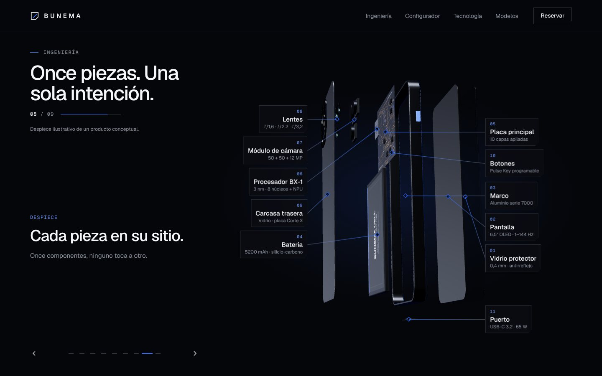
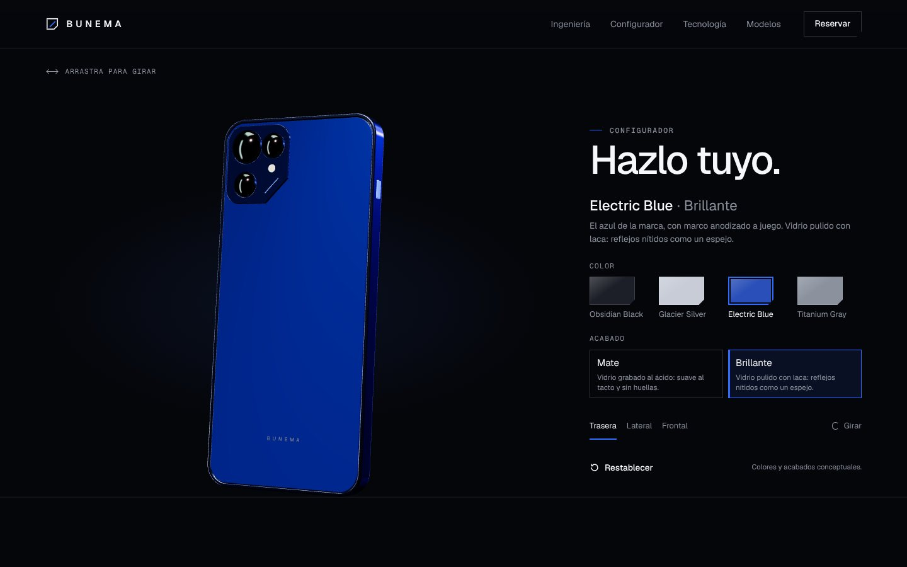
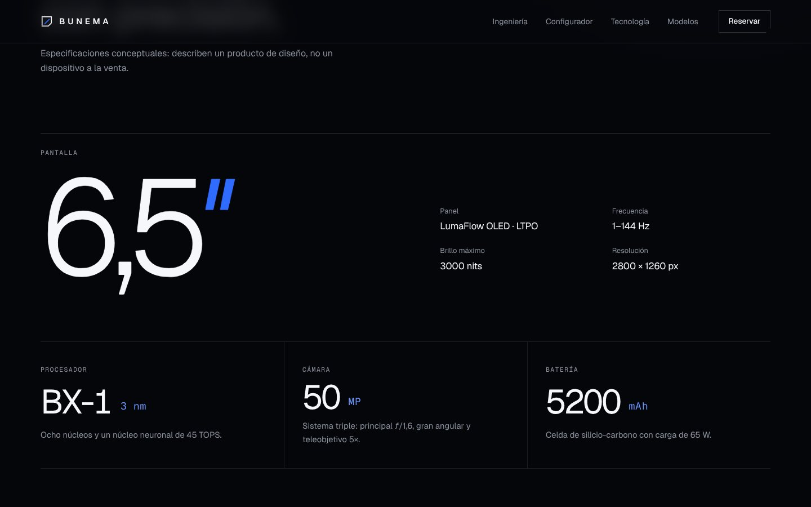
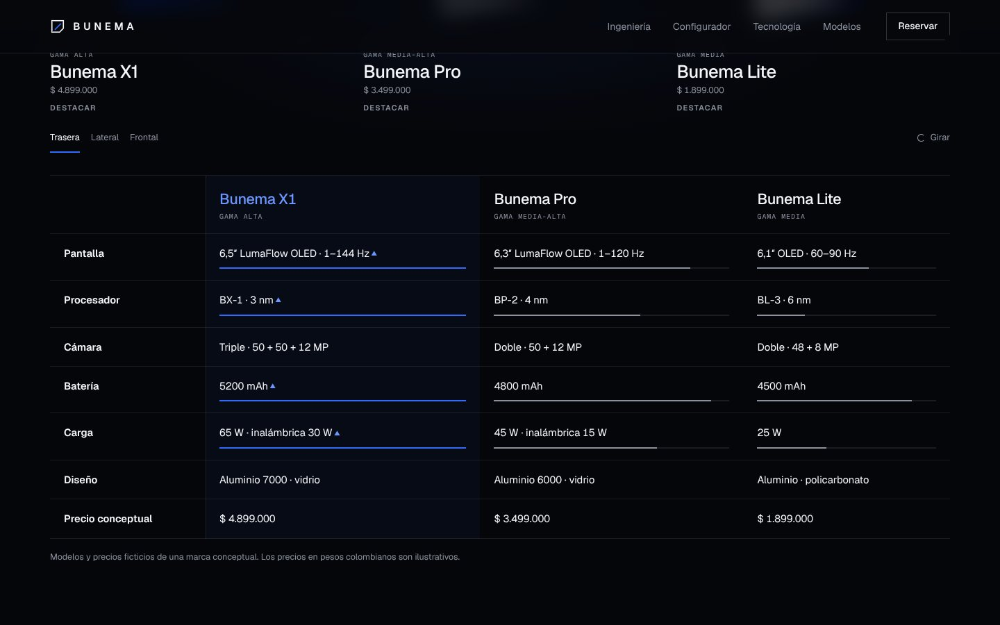

# BUNEMA TECHNOLOGY · Bunema X1

**Tecnología que se siente.** Experiencia web de producto para el **Bunema X1**, el smartphone de una marca conceptual: modelo 3D construido por código, despiece pieza a pieza controlado por scroll, configurador de color y acabado, especificaciones en composición editorial, comparador de la familia X Series y una reserva de demostración.

Proyecto de portafolio de **Sebastián Jaimes**.

> **Sitio:** [sebastianjaimesr.github.io/BUNEMA-TECNOLOGY](https://sebastianjaimesr.github.io/BUNEMA-TECNOLOGY/) · **Repositorio:** [github.com/sebastianjaimesr/BUNEMA-TECNOLOGY](https://github.com/sebastianjaimesr/BUNEMA-TECNOLOGY)

> BUNEMA TECHNOLOGY es una marca ficticia. El Bunema X1, sus especificaciones y sus precios no existen comercialmente.


## Recorrido

| Sección | Ancla | Qué hace |
| --- | --- | --- |
| Hero | `#inicio` | El X1 entra girando cuando la escena está lista; sigue al cursor, flota y se gira con el dedo en móvil. Dos acciones: *Explore Bunema X1* y *Discover the Engineering*. |
| Ingeniería | `#ingenieria` | Despiece de las 11 piezas del modelo sincronizado con el scroll, en 9 pasos, con etiquetas técnicas ancladas a cada pieza, indicador de progreso y control manual (anterior, siguiente y un botón por paso). |
| Configurador | `#configurador` | 4 colores y 2 acabados que cambian los materiales del mismo modelo 3D; vistas trasera/lateral/frontal, giro con arrastre o flechas del teclado, rotación automática y *Restablecer*. |
| Tecnología | `#tecnologia` | Pantalla, procesador, cámara, batería, materiales, diseño y rendimiento en una composición editorial. |
| Cámara | `#camara` | Demo simulada en Canvas 2D: zoom de 0,5× a 10×, modo noche y comparación con divisor. No usa la cámara del dispositivo. |
| Modelos | `#modelos` | X1, Pro y Lite en 3D a escala real con giro sincronizado y una comparación de 7 filas; el X1 conserva el protagonismo. |
| Reserva | `#reserva` | Cierre con formulario validado y accesible. Es una demostración: no hay servidor ni cobros. |

<table>
  <tr>
    <td></td>
    <td></td>
  </tr>
  <tr>
    <td></td>
    <td></td>
  </tr>
</table>

<p></p>

## Tecnologías

- **Vite 8** (build y servidor de desarrollo), JavaScript con módulos ES, sin framework.
- **Three.js** para el modelo y la escena; **GSAP + ScrollTrigger** para la entrada y el scroll.
- CSS propio con variables de diseño; tipografías **Geist** y **Geist Mono** (Google Fonts).

## Identidad visual

| Token | Valor | Uso |
| --- | --- | --- |
| Fondo | `#05060A` | Base de toda la página |
| Azul eléctrico | `#2F6BFF` | Acciones, progreso, luz de contorno del 3D |
| Blanco | `#F5F7FA` | Texto principal |
| Gris metálico | `#8B929E` | Texto secundario, marco Titanium Gray |
| Superficies | `#0A0C12` · `#10131B` · `#171B25` | Secciones alternas, paneles y estados |

La firma de la marca es el **Corte X**: la esquina a 45° de la placa de cámara, que se repite en los botones, el panel de reserva y el logotipo.

## Arquitectura

```
index.html                  Bunema X1 (experiencia principal)
tienda.html · admin.html    Archivo: The iPhone Experience (proyecto anterior) y su panel
concepto-x1.html            Redirección de la URL antigua del concepto a index.html
src/concepto-x1/
  main.js                   Orquesta: navegación, secciones y carga diferida del 3D
  experience.js             Arranque de la escena (se descarga con import() dinámico)
  scene/                    Renderer, estudio de luz (mapa de entorno), luces, sombra de contacto
  models/                   BunemaPhone (11 piezas), materiales compartidos, texturas por código, LineupPhone
  animations/               Hero, guion del despiece (función pura), scroll, configurador, vitrina
  sections/                 Interfaz del configurador, comparador, demo de cámara y reserva (sin Three.js)
  ui/                       Menú, control de pasos, etiquetas técnicas, apariciones, progreso de carga
  data/products.js          Colores, acabados, modelos y especificaciones: fuente única
  styles/                   Una hoja por sección + base y responsive
```

- **Un solo `WebGLRenderer` y un solo lienzo fijo** para toda la página: hero, despiece, configurador y vitrina mueven el mismo modelo (o los tres de la vitrina) en lugar de crear escenas nuevas.
- **Renderizado bajo demanda**: solo se dibuja un fotograma cuando algo cambia; con la escena quieta el coste de GPU es cero. Fuera de las secciones con 3D el bucle se pausa.
- **El despiece es una función pura del progreso de scroll** (`sequenceAt(p)`): subir, bajar o saltar con los botones produce siempre la misma pose.
- **Interfaz desacoplada del 3D**: configurador, comparador y reserva funcionan sin WebGL; el 3D se suscribe a su estado cuando está listo.

## Rendimiento

- Three.js (unos 150 kB gzip) **no bloquea el primer pintado**: se descarga con `import()` mientras el titular ya es visible. No hay pantalla de introducción que retrase el contenido.
- Sin modelos ni texturas descargadas: geometría paramétrica y texturas dibujadas en `<canvas>` (0 peticiones de recursos 3D). El mapa de entorno se genera una vez en la GPU.
- Materiales compartidos entre las piezas y entre los modelos de la vitrina; geometrías reutilizadas para componentes repetidos.
- Pixel ratio limitado (1,75 en móvil, 2 en escritorio) y animación ambiental a 30 FPS en móvil.
- Recuperación de contexto WebGL perdido y liberación de geometrías, materiales y texturas al desmontar.

## Accesibilidad

- Navegación completa por teclado, foco visible, enlace para saltar al contenido.
- El giro del configurador es un `role="slider"` (flechas, Inicio y Fin) que anuncia los grados.
- Radios nativos para color y acabado, `aria-pressed` en vistas, `aria-current` en el paso activo del despiece, regiones `aria-live` para los cambios.
- `prefers-reduced-motion`: sin flotación, sin transiciones y despiece estático con todas las etiquetas.
- Sin WebGL: ilustraciones SVG que siguen al configurador y la ficha de piezas visible.

## Ejecutar en local

Requisitos: Node.js 20 o superior.

```powershell
git clone https://github.com/sebastianjaimesr/BUNEMA-TECNOLOGY.git
cd BUNEMA-TECNOLOGY
npm install
npm run dev          # http://localhost:5173
npm run build        # genera dist/
npm run preview      # sirve dist/ en http://localhost:4173
```

## Publicar en GitHub Pages

1. En el repositorio: **Settings → Pages → Source: GitHub Actions** (ya configurado).
2. Cada push a `main` ejecuta `.github/workflows/deploy.yml`: `npm ci`, `npm run build` y despliegue de `dist/`. En los pull requests solo se ejecuta el build.
3. `vite.config.js` usa `base: './'`, así el mismo `dist/` funciona en la raíz o en `/BUNEMA-TECNOLOGY/`.

## Archivo: The iPhone Experience

El proyecto anterior (catálogo de iPhone en COP, fichas 3D, comparador, carrito y panel) sigue disponible en [`tienda.html`](https://sebastianjaimesr.github.io/BUNEMA-TECNOLOGY/tienda.html). Los enlaces antiguos del tipo `/#/catalogo` redirigen allí. Su documentación técnica está en [`docs/ARQUITECTURA.md`](docs/ARQUITECTURA.md) y [`docs/RECURSOS-PENDIENTES.md`](docs/RECURSOS-PENDIENTES.md); se regeneran sus renders con `npm run renders`.

## Limitaciones conocidas

- El modelo 3D es paramétrico (geometría generada por código), no un CAD ni un escaneo: es una representación conceptual y así se indica en la página.
- La demo de cámara es una ilustración con filtros; no realiza fotografía computacional.
- La reserva es una demostración sin servidor: los datos se borran al recargar.
