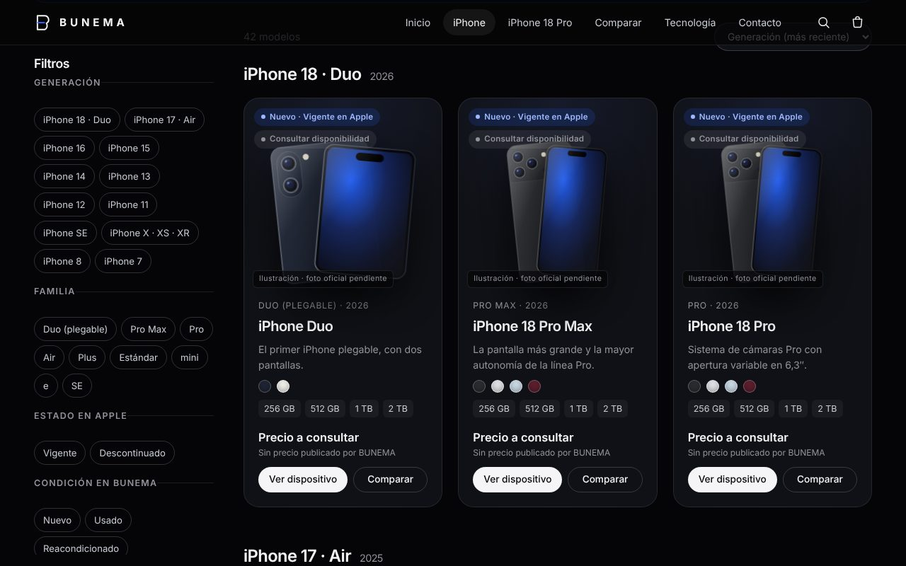
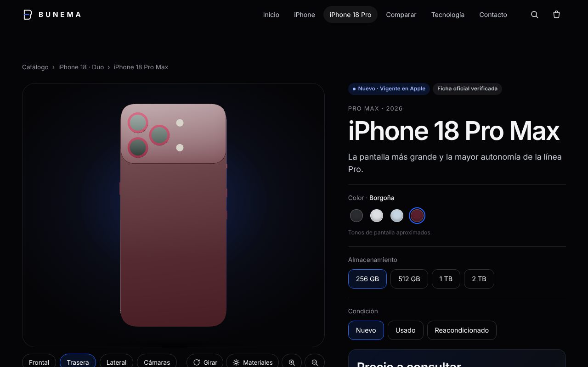
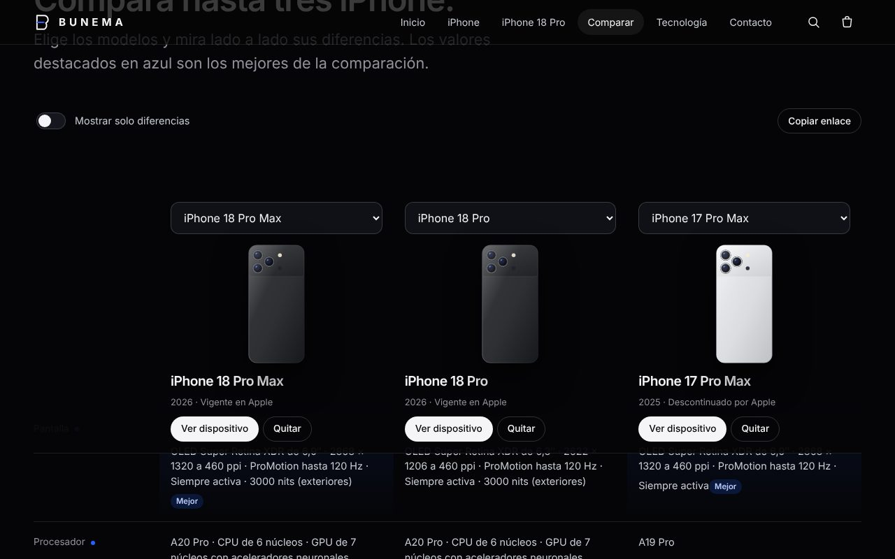
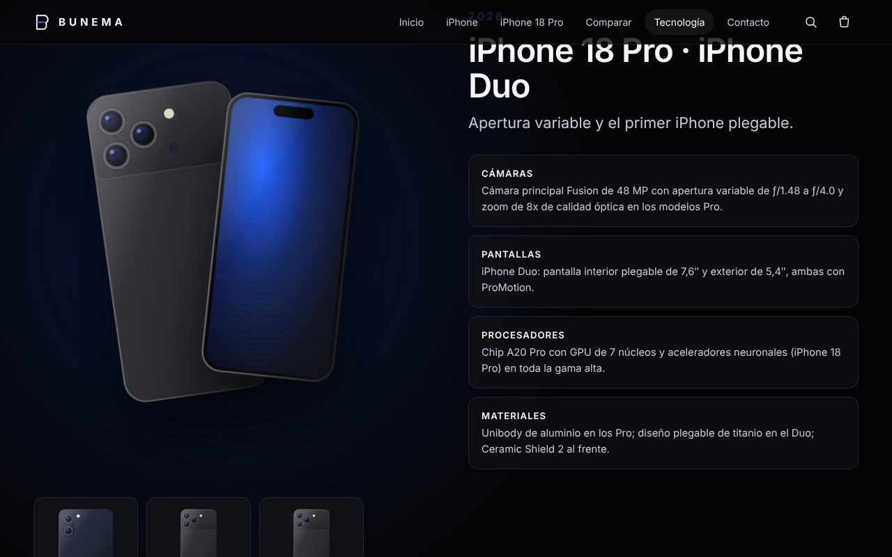
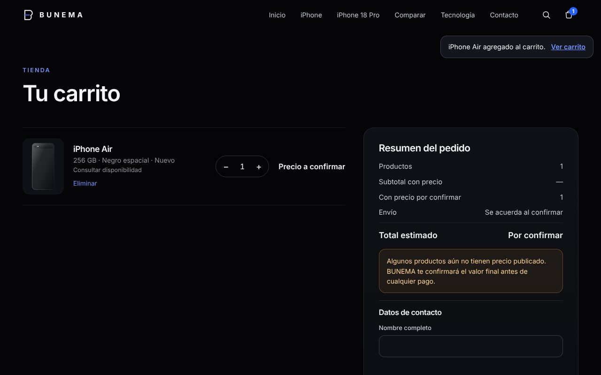
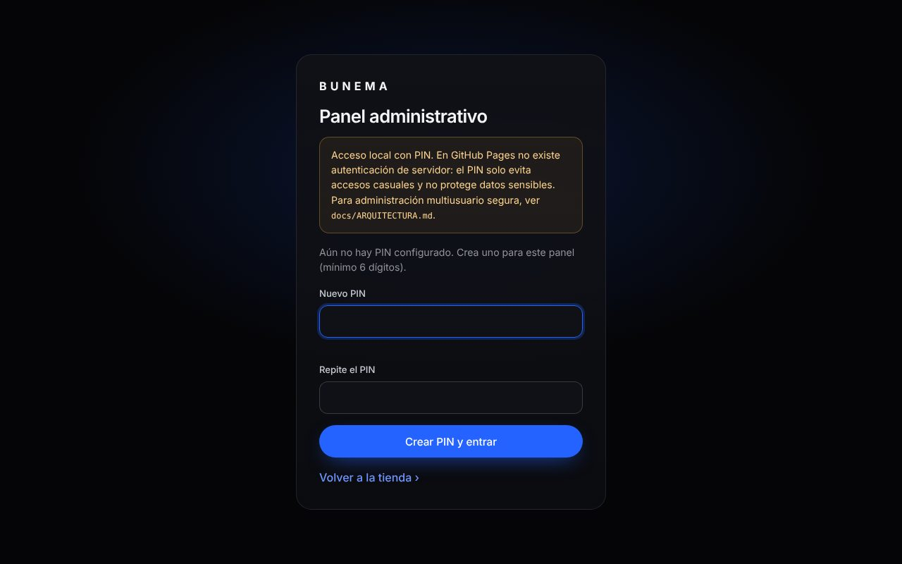
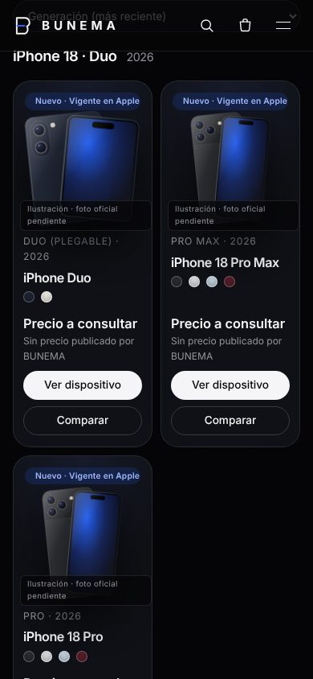

# BUNEMA · The iPhone Experience

**Technology Beyond Limits.** Plataforma web premium dedicada al universo iPhone para el mercado colombiano: presentación cinematográfica en 3D, catálogo completo por generaciones, fichas técnicas verificadas, configurador 3D, comparador, galería tecnológica, tienda con carrito en pesos colombianos y panel administrativo.

Proyecto de **Sebastián Jaimes**.

> **Sitio:** [sebastianjaimesr.github.io/BUNEMA-TECNOLOGY](https://sebastianjaimesr.github.io/BUNEMA-TECNOLOGY/) · **Repositorio:** [github.com/sebastianjaimesr/BUNEMA-TECNOLOGY](https://github.com/sebastianjaimesr/BUNEMA-TECNOLOGY)

> BUNEMA es una tienda independiente. No es Apple Inc. ni distribuidor autorizado de Apple. iPhone es una marca registrada de Apple Inc.


## Qué incluye

| Sección | Ruta | Qué hace |
| --- | --- | --- |
| Inicio | `#/` | iPhone 18 Pro Max en 3D con entrada animada, parallax con el ratón y recorrido por scroll (frontal → lateral → trasera) con datos oficiales. Línea actual de Apple, cifras del 18 Pro, recorrido horizontal por generaciones. |
| Catálogo | `#/catalogo` | 42 modelos, del iPhone 7 al iPhone 18 Pro Max y el iPhone Duo, agrupados por generación. Buscador en tiempo real y filtros por generación, familia, estado en Apple (vigente/descontinuado), condición (nuevo/usado/reacondicionado), disponibilidad, almacenamiento, color y precio. Los filtros viajan en la URL. Archivo histórico desde el iPhone de 2007. |
| Ficha | `#/iphone/<id>` | Configurador 3D (girar con ratón o gestos, acercar, vistas frontal/trasera/lateral/cámaras, rotación automática, inspección de materiales), selección de color, almacenamiento, condición y cantidad, precio de la combinación exacta, ficha técnica completa con su fuente oficial. |
| Comparador | `#/comparar?m=a,b,c` | Hasta tres modelos lado a lado; marca las filas con diferencias y el mejor valor numérico; «solo diferencias»; enlace para compartir. |
| Galería tecnológica | `#/galeria` | Un capítulo visual por generación con parallax, filtro por tema (cámaras, pantallas, materiales, procesadores, diseño, conectividad). |
| Carrito y pedido | `#/carrito`, `#/pedido/<id>` | Cantidades, total en COP, productos con precio por confirmar, formulario validado y solicitud de pedido con número. Envío por WhatsApp, correo o endpoint, impresión/PDF. **No hay cobros**: la solicitud se confirma con la tienda. |
| Contacto | `#/contacto` | Consulta de disponibilidad, prellenada desde la ficha. |
| Panel administrativo | `admin.html` | Productos, inventario y precios, pedidos y consultas, imágenes y modelos 3D, ajustes (WhatsApp, correo, pasarela), estadísticas y publicación de `store.json`. |
| BUNEMA Lab | `concepto-x1.html` | La experiencia anterior del teléfono conceptual Bunema X1, conservada y marcada como concepto. |

<table>
  <tr>
    <td></td>
    <td></td>
  </tr>
  <tr>
    <td></td>
    <td></td>
  </tr>
  <tr>
    <td></td>
    <td></td>
  </tr>
</table>

<p>
  
  
</p>

## Datos y verificación

- **Especificaciones** (`src/data/iphones.js`): una sola base de datos para catálogo, fichas, comparador, galería, carrito y panel. Se revisaron el 2 de noviembre de 2026 contra el comparador oficial de Apple Colombia (<https://www.apple.com/co/iphone/compare/>) y las páginas de especificaciones del iPhone Duo, iPhone 18 Pro / Pro Max, iPhone 17e y iPhone 16. Cada modelo guarda su fuente y la ficha la muestra.
- **Nombres de colores**: los oficiales. Las muestras y el 3D usan tonos aproximados (se indica en la ficha).
- **Precios, inventario y canales** (`public/data/store.json`): vacíos por defecto. Nada se inventa: sin precio se muestra «Precio a consultar» y sin WhatsApp configurado el botón lleva al formulario de contacto.
- **Imágenes**: este entorno no tuvo acceso a los servidores de imágenes de Apple, así que **no se descargaron fotografías oficiales**. Cada modelo y color muestra un **render 3D** generado con el mismo modelo del visor (medidas oficiales, módulo de cámaras, acabado), marcado «Render 3D ilustrativo · foto oficial pendiente». Los renders se regeneran con `npm run renders` (requiere Playwright con Chromium) y quedan en `public/assets/renders/`. La lista está en [`docs/RECURSOS-PENDIENTES.md`](docs/RECURSOS-PENDIENTES.md).
- **3D**: modelo paramétrico generado con Three.js a partir de las **medidas oficiales** y el diseño del módulo de cámaras de cada modelo; se rotula como ilustrativo. El visor carga un `.glb` real si se registra en el panel.

## Arquitectura

```
index.html            Tienda (SPA con rutas #/…)
admin.html            Panel administrativo (entrada independiente)
concepto-x1.html      BUNEMA Lab · concepto Bunema X1
public/
  data/store.json     Precios, inventario, canales, fotos (lo edita el panel)
  assets/images/…     Fotografías por modelo (pendientes)
  assets/models-3d/   Modelos .glb opcionales
src/
  main.js · router.js           Arranque y enrutador por hash (import() por página)
  config/site.config.js         Marca y valores por defecto
  data/                         iphones.js (42 modelos) · generations.js (galería)
  services/                     catálogo, tienda, carrito, pedidos, contacto, comparador,
                                estadísticas, formato COP, almacenamiento, pago (preparado)
  components/                   cabecera, tarjeta, ilustraciones SVG, bandeja del comparador,
                                formularios, avisos
  pages/                        home, catalog, product, compare, gallery, cart, order,
                                contact, legal, notFound
  three/                        PhoneModel (paramétrico) · PhoneViewer (visor reutilizable)
  animations/                   GSAP + ScrollTrigger, apariciones al desplazarse
  admin/                        panel
  styles/                       tokens, base, layout, componentes y una hoja por página
  concepto-x1/                  código del Bunema X1
```

Detalle técnico, limitaciones de GitHub Pages y la arquitectura de backend propuesta: [`docs/ARQUITECTURA.md`](docs/ARQUITECTURA.md).

**Rendimiento**: cada página y su CSS se cargan bajo demanda; Three.js solo se descarga en las vistas con 3D; el visor dibuja únicamente cuando algo se mueve y se pausa fuera de pantalla; renders en WebP de unos 10 KB con carga diferida; `prefers-reduced-motion` desactiva el recorrido animado. Sin WebGL se muestran las ilustraciones de cada vista.

## Ejecutar en local

Requisitos: Node.js 20 o superior.

```powershell
git clone https://github.com/sebastianjaimesr/BUNEMA-TECNOLOGY.git
cd BUNEMA-TECNOLOGY
npm install
npm run dev          # http://localhost:5173
npm run build        # genera dist/
npm run preview      # sirve dist/ en http://localhost:4173
npm run renders      # regenera los renders 3D (npm i -D playwright && npx playwright install chromium)
```

Panel: `http://localhost:5173/admin.html` (la primera vez pide crear un PIN).

## Publicar en GitHub Pages

1. **Settings → Pages → Source: GitHub Actions** (ya configurado).
2. Cada push a `main` ejecuta `.github/workflows/deploy.yml`: `npm ci`, `npm run build` y despliegue de `dist/`.
3. Para publicar precios, inventario, WhatsApp o fotos: en `admin.html` → **Publicar → Descargar store.json**, y sustituir `public/data/store.json` en `main`. El sitio se actualiza en unos minutos.

## Pendiente y dependencias

| Pendiente | Depende de |
| --- | --- |
| Fotografías oficiales de cada modelo | Descargar los recursos de prensa con permiso de uso y guardarlos en `public/assets/images/<modelo>/` |
| Precios, inventario, número de WhatsApp, correo | Datos del negocio (panel → Publicar) |
| Cobros en línea | Backend + cuenta en Wompi, ePayco o Mercado Pago |
| Pedidos centralizados, autenticación segura, varios administradores | Backend con base de datos (ver `docs/ARQUITECTURA.md`) |
| Modelos 3D `.glb` detallados | Archivos con licencia de uso |
