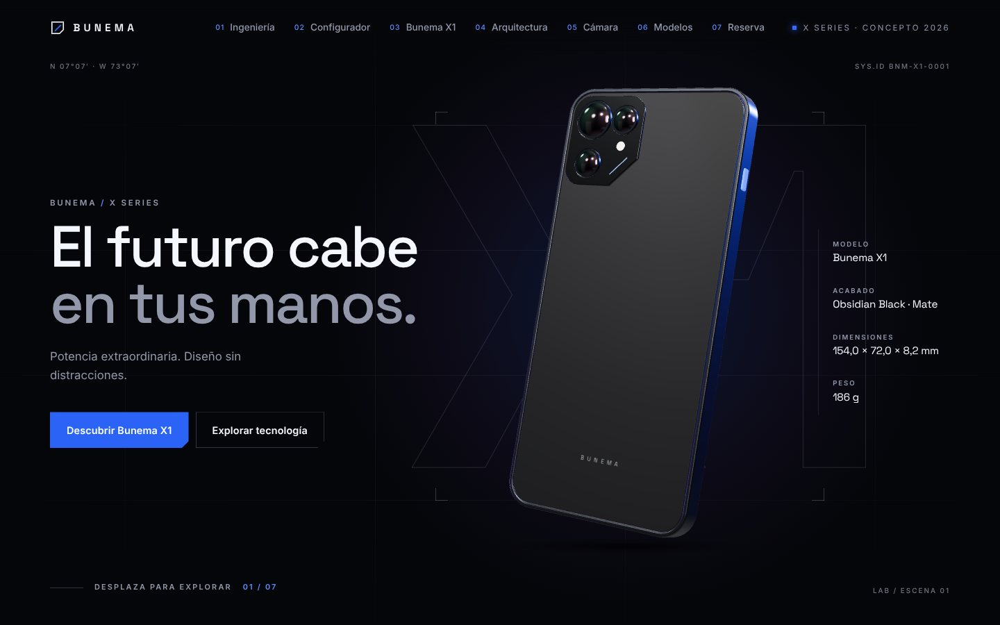
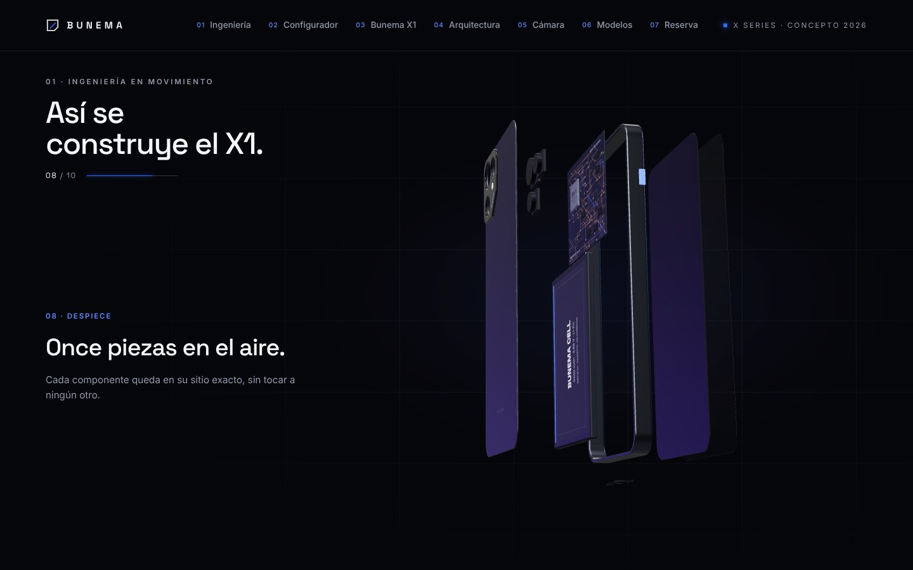
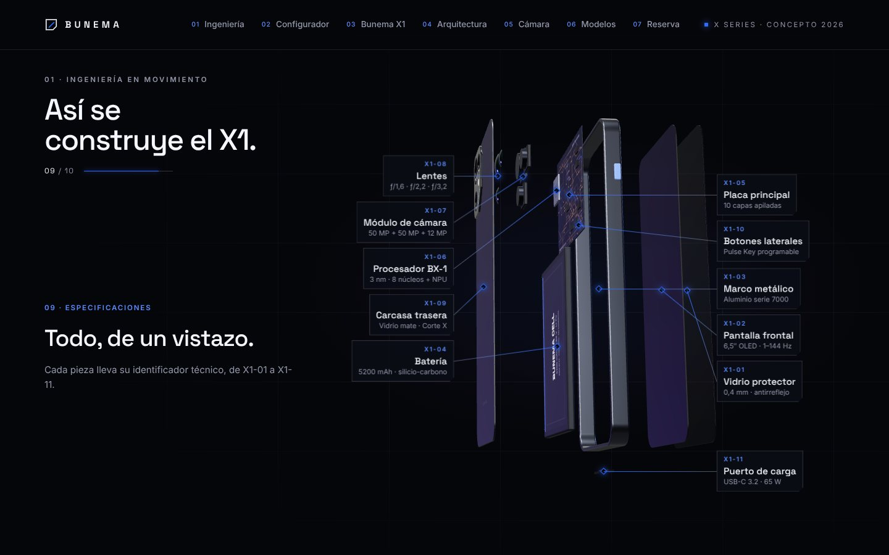
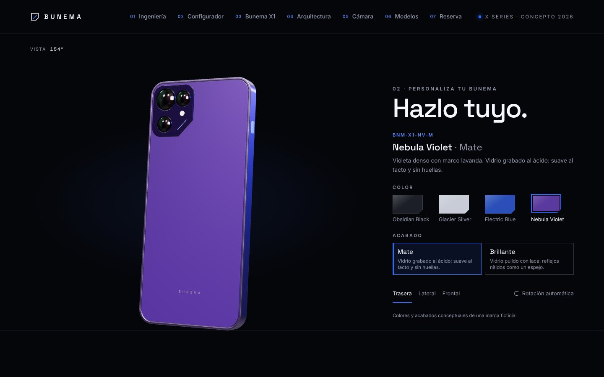
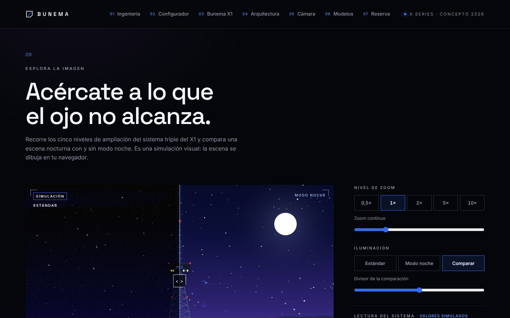
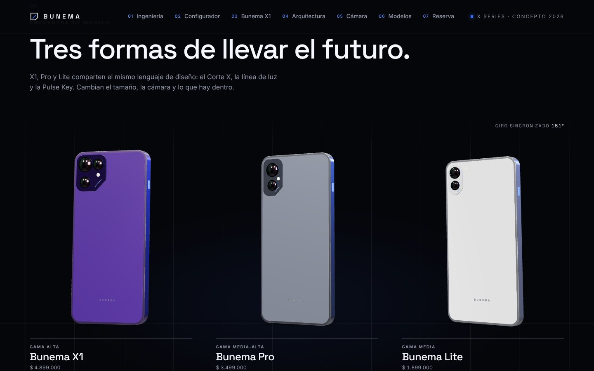
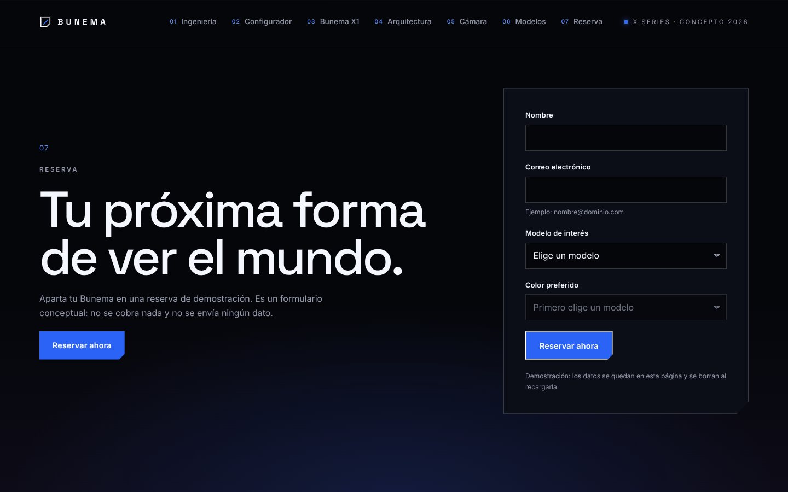
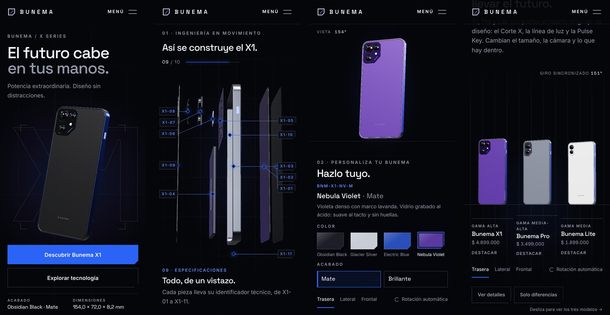
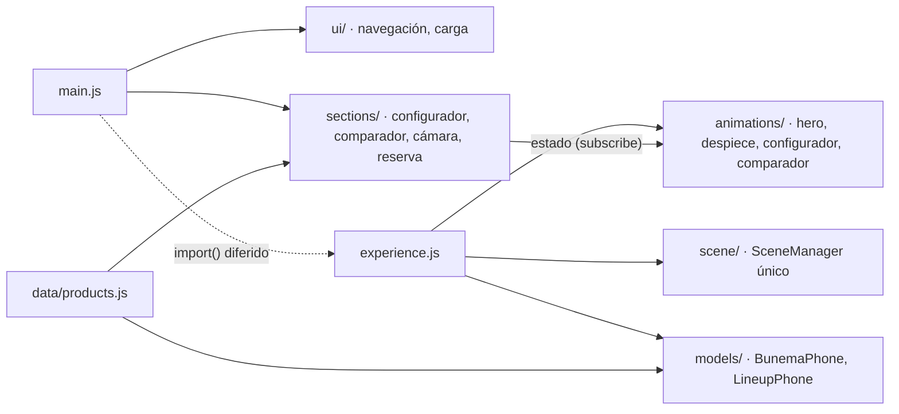

# BUNEMA TECHNOLOGY · Bunema X1

**Tecnología que se siente.** Experiencia web 3D, cinematográfica e interactiva para el lanzamiento del Bunema X1, el teléfono de una marca tecnológica **conceptual**.

Proyecto de portafolio por **Sebastián Jaimes**. BUNEMA, sus productos, especificaciones y precios no existen comercialmente.

> **Sitio publicado:** pendiente de verificación · **Repositorio:** pendiente de verificación



El teléfono se construye en el navegador con geometrías programáticas de Three.js: no hay modelos 3D, HDRI ni fotografías externas. Todo lo que ves en las capturas se genera con código de este repositorio.

## Qué incluye

| Sección | Qué hace |
| --- | --- |
| Introducción | Secuencia de entrada con una barra que refleja la **carga real** (tipografías, motor 3D, escena, modelo, shaders). Se puede omitir y respeta `prefers-reduced-motion`. |
| Hero | Teléfono 3D con flotación, rotación, reacción al cursor y arrastre táctil en móvil. |
| 01 · Ingeniería en movimiento | Despiece controlado por el scroll en 10 pasos: 11 piezas independientes se separan y se reconstruyen al volver, sin saltos. |
| 02 · Configurador | 4 colores × 2 acabados; los materiales cambian en vivo sobre el mismo modelo, sin reconstruir la escena. |
| 03 · Bunema X1 / 04 · Arquitectura | Cifras clave y la ficha de las 11 piezas. |
| 05 · Cámara | Simulación de zoom de 0,5× a 10×, modo noche y comparación con divisor. Escena ilustrada con Canvas 2D: **no** usa la cámara del dispositivo. |
| 06 · Modelos | Comparador X1 / Pro / Lite con tabla accesible, diferencias resaltadas y tres teléfonos 3D con giro sincronizado. |
| 07 · Reserva | Formulario conceptual con validación accesible. **No hay servidor ni pagos**: los datos solo viven en la página y la confirmación lo dice. |

<table>
  <tr>
    <td></td>
    <td></td>
  </tr>
  <tr>
    <td></td>
    <td></td>
  </tr>
  <tr>
    <td></td>
    <td></td>
  </tr>
</table>

En móvil se reorganiza cada sección sin quitar la experiencia principal:



## Tecnologías

- **[Vite](https://vite.dev/) 8**: servidor de desarrollo y build de producción.
- **JavaScript moderno** con ES Modules, sin frameworks.
- **[Three.js](https://threejs.org/) 0.186**: escena, materiales físicos (`MeshPhysicalMaterial`) y reflejos con `RoomEnvironment` + `PMREMGenerator`.
- **[GSAP](https://gsap.com/) 3.15 + ScrollTrigger**: introducción, transiciones y despiece ligado al scroll.
- **HTML5 semántico y CSS3**: diseño mobile first, sin Tailwind ni librerías de componentes.

No hay más dependencias de ejecución que `three` y `gsap`.

## Instalación y uso

Requisitos: [Node.js](https://nodejs.org/) 20 o superior. Comandos para Windows PowerShell:

```powershell
git clone <URL-del-repositorio>
cd bunema-technology
npm install
npm run dev        # http://localhost:5173
```

| Script | Para qué |
| --- | --- |
| `npm run dev` | Servidor de desarrollo con recarga en caliente. |
| `npm run dev:host` | Igual, pero accesible desde el móvil en la misma red Wi-Fi. |
| `npm run build` | Genera la versión de producción en `dist/`. |
| `npm run preview` | Sirve `dist/` en http://localhost:4173 para probar el build. |

## Arquitectura

`main.js` es el punto de entrada y solo orquesta. Las secciones HTML funcionan desde el primer momento, y el 3D (Three.js, el archivo más pesado) se descarga después con `import()` dinámico: el texto ya se puede leer y navegar mientras llega.



```
src/
├── main.js                 Punto de entrada: crea las secciones y carga el 3D en diferido
├── experience.js           Arranca la parte 3D y devuelve reveal() y dispose()
├── scene/                  SceneManager (renderer único, render bajo demanda), luces, entorno, sombra
├── models/                 El X1 por piezas, sus materiales, texturas de canvas y los modelos del comparador
├── animations/             Intro, hero, despiece con ScrollTrigger, poses del configurador y del comparador
├── sections/               Lógica de interfaz sin 3D: configurador, comparador, demo de cámara, reserva
├── data/products.js        Fuente única de modelos, colores, precios y especificaciones
├── loading/LoadTracker.js  Etapas reales de carga para la barra de la intro
├── ui/                     Menú, indicador de carga y etiquetas técnicas
└── styles/                 Un archivo CSS por sección + base, layout y responsive
```

Las secciones de interfaz (`sections/`) no conocen Three.js: exponen su estado con `subscribe()` y la parte 3D se suscribe cuando está lista. Por eso el configurador, la tabla, la cámara y la reserva funcionan igual sin WebGL.

## Decisiones técnicas

- **Un solo renderer y una sola escena.** Un `<canvas>` fijo detrás de la página dibuja el hero, el despiece, el configurador y los tres modelos del comparador. Cada sección mueve el mismo teléfono en lugar de crear otra escena, y al redimensionar la ventana nunca se crea un segundo renderer.
- **Render bajo demanda.** Solo se dibuja un fotograma cuando algo cambia. La animación ambiental (flotación) va a 30 FPS en móvil, y el 3D se pausa cuando sale de pantalla o la pestaña se oculta.
- **Calidad según el dispositivo.** Con un puntero táctil, una pantalla estrecha o pocos núcleos de CPU se limita el pixel ratio (1,75 frente a 2) y se reduce el filtrado de texturas.
- **Despiece reversible.** Cada pieza interpola entre su pose de montaje y la de despiece según el progreso del scroll, así que avanzar y retroceder pasa por los mismos estados.
- **Materiales en vivo.** El configurador cambia color, rugosidad y clearcoat de materiales que ya existen, con una transición, sin crear geometría nueva.
- **Datos centralizados.** `products.js` alimenta la tabla, los modelos 3D del comparador (medidas en mm a escala real) y las opciones de la reserva.
- **Limpieza.** `dispose()` libera geometrías, texturas, el render target del entorno, ScrollTriggers, observadores y listeners, y se usa en la recarga en caliente de Vite.

## Accesibilidad

- Contraste AA: el azul de marca `#2F6BFF` se reserva para superficies, y el texto pequeño usa `#5B8AFF` (6,3:1).
- Navegación completa por teclado, foco visible, enlace «Saltar al contenido» y áreas táctiles de 44 px o más.
- Formularios con etiquetas, errores enlazados con `aria-describedby`, un resumen de errores con enlaces y foco gestionado.
- Alternativa sin WebGL: ilustraciones SVG y todo el contenido en HTML. Si el contexto WebGL se pierde, aparece la alternativa, y el 3D vuelve al restaurarse.
- Con `prefers-reduced-motion`, la intro se omite y las transiciones son instantáneas.

## Pruebas realizadas

Durante el desarrollo verifiqué cada fase con scripts de Playwright, en Chromium sin interfaz y con WebGL por software:

- interacciones;
- despiece en ambos sentidos;
- configurador, comparador, cámara y reserva;
- responsive de 320 a 1920 px, también en horizontal;
- accesibilidad con axe-core, sin fallos en 5 estados de la página;
- pérdida de WebGL;
- fallo de carga del módulo 3D;
- liberación de memoria con `dispose()`.

Esos scripts no forman parte del repositorio porque dependen de mi entorno de pruebas.

**Límites honestos:**

- No he medido los FPS en un dispositivo físico. El objetivo es acercarse a 60 FPS en equipos compatibles, sin prometer una tasa fija.
- No he probado con lectores de pantalla reales; la accesibilidad está verificada con axe y con pruebas de foco y ARIA.

## Despliegue

`.github/workflows/deploy.yml` publica en GitHub Pages con cada push a `main`. Pasos del workflow:

1. `npm ci`
2. `npm run build`
3. Sube `dist/` a Pages.

En los pull requests solo se compila. Para activarlo, en el repositorio ve a **Settings → Pages → Source: GitHub Actions**.

`vite.config.js` usa `base: './'`, de modo que el mismo build funciona en local y bajo la subruta de Pages sin escribir el nombre del repositorio en el código.

## Créditos

Diseño, código y modelado programático: **Sebastián Jaimes**, como proyecto de portafolio. Tipografías [Space Grotesk](https://fonts.google.com/specimen/Space+Grotesk) e [Inter](https://fonts.google.com/specimen/Inter) (SIL Open Font License), servidas por Google Fonts. `RoomEnvironment` es parte de Three.js (licencia MIT).

BUNEMA TECHNOLOGY es una marca conceptual. Los perfiles de redes sociales del pie de página son inventados y no existen.
